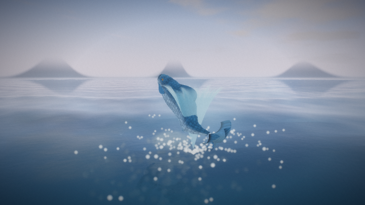
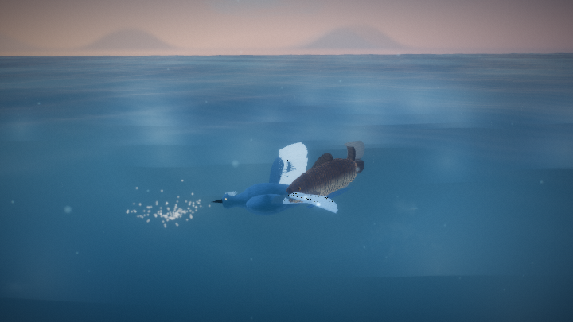

# 鲲鹏 · 一次开源仓库的复刻实验

> 想复刻一下 [ChetasLua/crimson-loong](https://github.com/ChetasLua/crimson-loong)——一个用纯 three.js、零外部素材、在单个 HTML 里做出 90 秒电影的开源仓库。
> 这是我从「照着做」到「自己写」的完整记录，以及最后做出来的东西。

- **在线看（网页版）**：<https://yukhughkui.github.io/crimson-loong-replica/>
- **完整视频（从头到尾）**：[kunpeng-film.mp4](video/kunpeng-film.mp4) · [直接下载](https://raw.githubusercontent.com/yukhughkui/crimson-loong-replica/main/video/kunpeng-film.mp4)

网页版是交互式的：空格暂停/继续，点击页面开启合成配乐，也可以拖到任意时刻（地址栏加 `?t=24&pause`），甚至在控制台里用 `window.__film.setTime(24.6)` 精确跳帧。
如果不想摆弄网页、只想一口气从头看到尾，直接看上面的视频就行。



---

## 一、缘起：先把原作逐字抄一遍

最开始我以为「复现」就是自己写一个类似的东西，结果做出来的画面和原作差了十万八千里。后来才明白一件事：**代码生成不等同于随机生成——把同样的代码交给浏览器，本来就该得到同样的画面。**

于是我把原仓库的 `src / tools / vendor` 完整逐字复制到本地 `faithful/`，重新构建，产物与上游 `index.html` 的 SHA-256 完全一致：

```
e250f6875895c17783b45a01cb6eaacf3d7216b2a0ca9df82763622d94b17037
```

这一步的意义不是「交差」，而是确认了差距的来源：不是浏览器、不是显卡、不是运气，**就是代码本身**。原作之所以真实，是因为它写了 SDF 建模、共享 GLSL 光照块、运行时贴图烘焙、体积云、半浮点 HDR 后期、AO、体积光，并且逐秒调参。我没有这些东西。

> 说明：原仓库没有附带代码许可证（仅 three.js 是 MIT），所以我只把「逐字复刻并校验哈希」这件事写进记录，没有把原作源码放进这个公开仓库。

## 二、第一版：自己写的，但差得很远

接下来我从零做了一个原创短片《鲲鹏》——同样是 90 秒、单 HTML、零外部素材，主题是「渊 → 跃 → 化 → 飞」。

第一版大约 761 KB，有程序化礁石、湖面、天空、双生物、粒子特效、Web Audio 合成配乐和两级泛光。技术上看着该有的都有了，**但画面一眼就能看出是低多边形风格，和原作的照片级质感差得很远**。

这不是调几个参数能补上的差距。于是我停下来，去读原作的实现思路，然后一轮一轮地追。

## 三、之后：12 个版本，两天时间

从 2026 年 11 月 19 日到 20 日，我把原作的关键系统逐个吃透、迁移、再按自己的题材重写。从初版到最终版一共 **12 个版本（11 轮针对性迭代）**，大致轨迹如下：

| 版本 | 这一轮解决的核心问题 |
| --- | --- |
| 初版 | 从零搭出 90 秒单文件短片，但质感明显不足 |
| 迭代 2 | 移植原作三大全局系统：解析 HDR 天空、云影场 + 双介质大气雾 `clFog`、完整后期（4 级泛光 + 体积光 + ACES）；鹏翼改为逐根飞羽几何 |
| 迭代 3 | 鲲的上千片独立鳞片几何 + 次表面透亮；鹏的连续翼膜；4 组 Gerstner 波海面 + 菲涅尔 |
| 迭代 4 | 水下光学：焦散系统、水下吸收雾、海床、潜入水下的镜头 |
| 迭代 5 | 从实际截图倒推，修掉五处一眼假的硬伤 |
| 迭代 6 | 改结构：生物解剖 + 水下体积光 |
| 迭代 7 | 重写焦散算法、纠正海面法线，去掉规则网格感 |
| 迭代 8 | **确定性物理引擎**：RK4 预积分成轨迹表，运行期按时间采样，兼顾力学真实与任意跳帧 |
| 迭代 9 | 修建模朝向逻辑；加入青蓝鹏与暖铜色对手巨鲲的海天缠斗 |
| 迭代 10 | 用红/绿材质诊断定位困扰多轮的「鹏翼成排黑点」根因；水花分层；离屏加载稳定 |
| 迭代 11 | 用颜色注入诊断找到水下「笔直亮线」来自天空球，修正颜色连续性 |
| 迭代 12 | 把破水的离散点云升级成由弹道驱动的连续水冠曲面 |



## 四、最终版

最终是 `index.html` 一个文件，约 840 KB，双击就能离线运行，`file://` 下不需要服务器。里面包含：

- **共享光照**：所有材质走同一套 `clLight`，配 `clFog` 大气/水下吸收、`clCaustic` 焦散
- **程序化资产**：岩石/鳞片/羽毛/云密度贴图在加载时烘焙，远礁用 SDF
- **确定性物理**：二次阻力弹道、气泡终端速度、Kármán 涡街侧力、欠阻尼振子；构建期 RK4 预积分，所以 `?t=52&pause` 能直接跳到正确的那一帧
- **90 秒叙事**：渊中潜行 → 破水 → 化形 → 海天缠斗 → 高空归云
- **声音**：Web Audio 合成的五声音阶配乐与撞击音效（点击页面开启）
- **技术底层**：three.js r180、单文件内联、半浮点 HDR 两级泛光、ACES 调色

本地重建：

```bash
python tools/build.py     # 由 src/*.js + vendor/three 生成 index.html
node tools/record_video.mjs   # 需先启动带 CDP 的 Chrome，逐帧渲染用于录视频
```

## 五、还差在哪里

必须说实话：这仍然是**风格化短片，不是照片级 CGI**。和原作的客观差距还在——鹏翼俯视角度仍有少量暗点、水冠是解析旋转面而非真实流体曲面、水下亮线淡化后水色过渡偏平、生物解剖与水体次表面远不如原作精细。

但作为一次「复刻开源仓库」的实验，它完成了它该完成的：从「抄一遍确认差距真实存在」，到「知道自己缺什么」，再到「一样一样补回来」。

## 六、许可与致谢

- three.js：MIT，见 `vendor/LICENSE`
- 原仓库 [ChetasLua/crimson-loong](https://github.com/ChetasLua/crimson-loong)：仅作学习参考，未分发其源码
- 本仓库中的原创代码、画面与视频：作者 yukhughkui

作者：云渡禅穹
